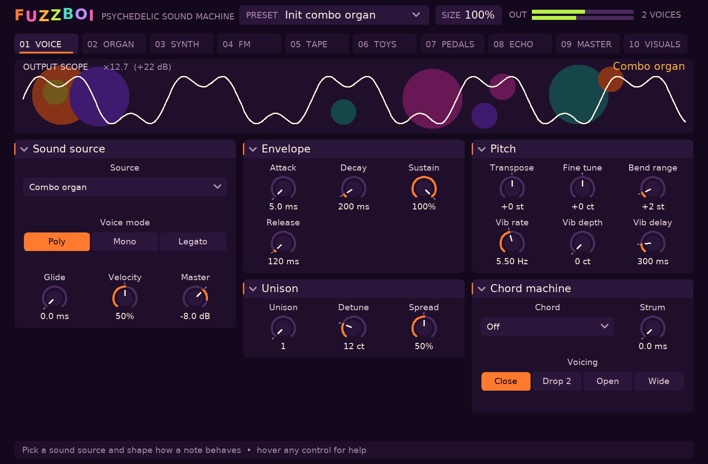

# FUZZBOI — psychedelic sound machine

FUZZBOI is a cross-platform CLAP instrument. It builds on Linux, Windows and macOS with
a native editor on all three (X11, Win32, Cocoa).

Every page: [VOICE](docs/screenshots/page1.png), [ORGAN](docs/screenshots/page2.png),
[SYNTH](docs/screenshots/page3.png), [FM](docs/screenshots/page4.png),
[TAPE](docs/screenshots/page5.png), [TOYS](docs/screenshots/page6.png),
[PEDALS](docs/screenshots/page7.png), [ECHO](docs/screenshots/page8.png),
[MASTER](docs/screenshots/page9.png), [VISUALS](docs/screenshots/page10.png), and the
[source menu](docs/screenshots/menu.png).

## What is in it

**Thirteen sound sources**, each a small model of the real thing rather than a sample:

| Source | What it models |
|---|---|
| Combo organ | Divide-down transistor organ: six footage drawbars, flute/reed blend, key click, percussion, scanner vibrato, Lowrey "marimba repeat" |
| Analog synth | Two band-limited oscillators with interval and detune, sub, noise, PWM, a tanh ladder filter with its own ADSR, key tracking and drive |
| FM electric | A YM2151 chip (Aaron Giles' ymfm) driven through its registers: eight 4-operator patches, brightness, envelope, feedback, chip LFO |
| Tape keys | Mellotron mechanics: eight seconds of tape per key (or endless), wow, flutter, hiss, head loss, varispeed; synthesized flute, strings and choir banks or your own WAV |
| Toy piano, music box | Struck steel rods: inharmonic clamped-bar partials (2.80x, 5.49x), hammer hardness, damping |
| Electric jug | A sung pulse, tongued flutter, a Helmholtz resonance and an overdriven mic |
| Theremin | Gliding near-sine with the asymmetry of the real output stage; stack up to eight |
| Singing saw | Bowed sine with slow wide vibrato and bow scrape |
| Plastic piccolo | Odd-harmonic tone, breath, chiff, and tuning that wanders |
| Stylophone | A single buzzy relaxation oscillator with the on/off vibrato |
| Jangle 12-string | Extended Karplus-Strong string pairs (pick-position comb, strings that bend with the pitch, velocity-bright picks, an electric pickup or an acoustic body), octave strings below the B course |
| Collage sampler | Sixteen slots across the keys, slices that jump and reverse, scatter, Optigan disc character; empty slots play built-in found sound |

**The chord machine**: one key becomes a
major, minor, sus, seventh, ninth, fifths or octave chord, voiced close, drop-2, open or wide,
played together or strummed low to high over a set time. Releasing the key releases the chord;
a strum that has not finished is dropped.

**The effects chain**, in order: amp feedback (a harmonic of the held note howls up over a swell),
fuzz (Big Muff, Fuzz Face and Tone Bender models, a cranked Plexi head for the brown sound, and an
Octavia-style octave fuzz), a speaker cabinet (tweed combo, British 4x12,
top-boost combo), phaser (2 to 8 stages with feedback), the Juno
bucket-brigade chorus (I, II, I+II, a three-phase Ensemble and a jet flanger), rotary speaker (horn and drum
with Doppler), tremolo (sine, square, bias), three-head tape echo (wow, saturation, age, runaway
feedback, tempo sync), spring reverb (dispersive allpass chains after Parker), chamber (Freeverb
tunings, with a shimmer that feeds its tail back an octave up), Wall of Sound (doubling, chamber send, squash), the pump (tempo-locked sidechain-style
ducking of the whole mix, echoes included), backwards, lo-fi, and the master tape machine
(drive, wow, flutter, hiss, bandwidth, and up to six cassette-to-cassette generations).

**Ninety presets**: from "Bright Vox organ" and "Electric jug" through
"Eight-theremin swarm", "Marimba-repeat organ", "Quarter-tone lead", "Polymoog strings", "Warbling
tape collage" and "Space Echo dub" to the second round's "Pumping Juno pad", "Phased octave lead",
"Pumping pluck bass", "Strummed maj 7 jangle", "Omnichord dream", "Strummed FM bells" and the sample
bank presets, and the fourth round's shoegaze, fuzz, brown-sound, drone and chillwave sounds: "Reverse-gate
glide", "Shimmer chime wall", "Jawari buzz raga", "Jet-flanged Plexi", "Dive-bomb Plexi", "Sub-octave doom
drone", "Swelling tape loop", "Sunbleached Juno pad" and more. Every preset is measured against the [quality bar](docs/QUALITY.md) by
`build/fuzzboi-preset-audit` and held to it by the test suite. Sixteen voices, poly/mono/legato,
unison with stereo spread, sustain pedal, pitch bend, mod wheel vibrato, CLAP and MIDI note
dialects, sample-accurate events, parameter modulation, and state that carries loaded samples.

**A sample bank** of thirteen permissively licensed excerpts harvested from archive.org (toy
piano, music box, theremin, an Omnichord, a harmonium, a ghanta bell, a singing bowl, tingsha, a
gong, shortwave, temple bowls, a geyser and rain) sits in `assets/samples/` with its licences and
checksums in the manifest; see [docs/SAMPLES.md](docs/SAMPLES.md).

Sample loading and harvesting is in [docs/SAMPLES.md](docs/SAMPLES.md)

The output scope triggers on each cycle and amplifies quiet playing (up to +24 dB, gain shown)
so the waveform is always readable. The VISUALS page is a MilkDrop/projectM-style feedback
visualizer patterned after LOAMP's: eight presets (tunnel, kaleidoscope, lava lamp, starburst...)
driven by the output's bass, mid and treble, with previous / next / random / auto cycling.

## Building

Requirements: CMake 3.20+, a C++20 compiler, and on Linux `libx11-dev`, `libxft-dev` and
`pkg-config` (plus DejaVu fonts at run time). The CLAP headers and ymfm are fetched at configure
time, pinned by tag and commit.

    cmake -S . -B build -G Ninja -DCMAKE_BUILD_TYPE=Release
    cmake --build build
    ctest --test-dir build --output-on-failure
    cmake --install build --prefix ~/.local      # puts FUZZBOI.clap in ~/.local/clap

Offline, point the fetches at existing checkouts:

    cmake -S . -B build -DFETCHCONTENT_SOURCE_DIR_CLAP=/path/to/clap -DFETCHCONTENT_SOURCE_DIR_YMFM=/path/to/ymfm

`-DFUZZBOI_EDITOR=OFF` builds without the native editor (the host's generic panel still works);
`-DFUZZBOI_COVERAGE=ON` instruments the tests for `gcovr`.

## How it is tested

Every suite is a plain executable with Given/When/Then scenarios (`tests/spec.hpp`); the
`features/` directory maps each scenario to its test. Nothing depends on a display, audio
hardware, installed plug-ins or the network.

| Suite | Proves |
|---|---|
| `dsp_tests` | oscillators, filters, envelopes and helpers, measured in Hz, cents, dB and ms |
| `sources_tests` | each sound source's pitch and character (bar partials, jug flutter rate, tape run-out, ...) |
| `fx_tests` | each effect's advertised behaviour (echo tap times, tremolo rate, fuzz harmonics, ...) |
| `engine_tests` | polyphony, mono/legato, unison, FM channel sharing, pedal, bend, tails, the chord machine and strum, every preset against the quality bar |
| `plugin_smoke`, `note_tests`, `state_tests` | the built `.clap` through the public CLAP ABI: discovery, ports, parameters, events at sample offsets, MIDI, presets, state round trips, malformed state |
| `advertised_tests` | one proof per parameter from audio; fails if a parameter has no proof |
| `ui_tests` | the real page table and editor against a fake host that enforces gesture rules and a canvas that records drawing |
| `frontend_tests` (Linux) | the plug-in side of the editor: gestures reaching the host as CLAP events, relevance rules, help, page artwork drawn from a running instance, all without a window |
| `harvest_tests` | the archive.org harvest tool's licence filter and manifest, against a fake archive |

`build/fuzzboi-ui-preview <dir>` renders every editor page offscreen on Linux for review,
`build/fuzzboi-preset-audit <dir> [samples]` renders and measures every preset (see
[docs/QUALITY.md](docs/QUALITY.md)), and `tools/coverage.py` reports line coverage from a `-DFUZZBOI_COVERAGE=ON` build (92.7% of `src/` at
the time of writing, excluding the platform window code, which needs a display).
[AGENTS.md](AGENTS.md) is the verification contract for changes.

## Layout

    src/params.hpp        the parameter table (ids, ranges, units, option names)
    src/presets.hpp       the factory presets
    src/dsp/              sound sources and building blocks (header-only, allocation-free when rendering)
    src/dsp/fx/           pedals, echoes, master section
    src/engine.hpp        voices, sample bank, FM chip, the chord machine, the effects chain
    src/fuzzboi.cpp       the CLAP plug-in (the only file that includes CLAP besides the tests)
    src/ui/               the editor: canvas, layout, widgets, pages, artwork, native backends
    tests/                scenario suites and the CLAP harness
    tools/                harvest_archive.py, ui_preview.cpp, preset_audit.cpp
    assets/samples/       the harvested sample bank and its manifest
    features/             Gherkin scenarios mapped to tests

## Licence

See [LICENSE](LICENSE) (source-available) and [THIRD_PARTY_NOTICES.md](THIRD_PARTY_NOTICES.md)
(ymfm, CLAP, Freeverb tunings, and the editor engine adapted from YANES).
